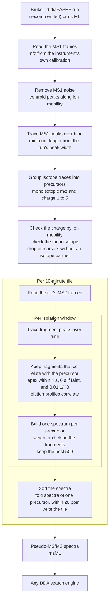

<p align="center"></p>

# DIAspeXtract

DIAspeXtract turns DIA data into pseudo-MS/MS spectra that any DDA search engine can search. It reads Bruker
timsTOF **diaPASEF** runs and DIA data **without ion mobility** (Orbitrap, SWATH): Thermo `.raw` files directly, or
centroided mzML or mzPeak, also from S3 (`s3://`). It finds
the precursor ions in the MS1 scans, collects the fragments that elute with each precursor (on diaPASEF data also at
the same ion mobility), and writes one MS2 spectrum per precursor to mzML. It uses no spectral library, so an
**open or blind search** of the output can find sequence variants and unexpected modifications. It is a standalone
application under BSD-3-Clause that links a patched OpenMS.

The two kinds of input take separate paths: input without ion mobility never enters the diaPASEF processing
described below, and its own path is summarised under [Input without ion mobility](#input-without-ion-mobility).

Earlier releases were named speXtract (up to 1.1.0) and DIAspeXtractor (1.2.x); [CHANGELOG.md](CHANGELOG.md) maps
the old names to the current ones.

## How it works



- **Read.** A `.d` is read frame by frame, and flight time becomes m/z through the acquisition's own calibration.
  MS1 frames are denoised with a port of dnoise (Garrett, Diedrich & Yates III, bioRxiv 2026.08.27.747603) and
  centroided along ion mobility. An mzML input is read whole, without noise removal (see [Run](#run)).
- **Precursors.** Traces one isotope apart at the same ion mobility form a precursor with a monoisotopic m/z and a
  charge from 1 to 5. Ion mobility corrects charge calls, the monoisotope is checked against the isotope pattern,
  and precursors without an isotope partner are dropped. Some tolerances are measured from each run.
- **Fragments.** In each isolation window, the MS2 peaks are traced over time on the instrument's flight-time bins.
- **Co-elution gate.** A fragment joins a precursor's spectrum when their apexes lie within 4 s and 0.01 1/K0 and
  their elution profiles correlate (r ≥ 0.3 over at least 3 shared points; frames without signal count as zero). A
  faint precursor, seen in at most 4 frames, gets a looser test: apexes within 6 s and overlapping elution spans; at
  the defaults its fragments are not judged by correlation at all ([docs/options.md](docs/options.md#co-elution-gate)).
- **Spectrum.** Fragments are weighted by their ion-mobility distance and their correlation. Leftover isotopes of
  other precursors in the window are removed, split peaks of one fragment ion are fused, and the best 500 fragments
  are kept; a spectrum needs at least 3. A precursor found twice gets one spectrum with the fragments of both, so it
  can hold more than 500.
- **Tiles and memory.** Tiles run in time order, and the next tile is read while the current one runs. On Linux and Windows, a
  window starts only when it fits in 75 % of the free memory (under a Slurm or container memory limit, of the room
  left under it); elsewhere windows run one at a time. The output does not depend on the thread count or the tiling.

### Input without ion mobility

An mzML or mzPeak without ion mobility at MS1 (centroided, one isolation window per MS2 scan), or a Thermo `.raw` file
(read centroided), takes a separate path. A FAIMS run is split by compensation voltage, each voltage takes this path on
its own, and its spectra carry their voltage. Biosaur2
finds the precursors (averagine-checked isotope patterns, charge 1 to 4) in the whole run's MS1 scans; isotope
envelopes of unfragmented precursors in a window's MS2 traces are added when MS1 lacks them. In each isolation window
the MS2 peaks are traced over time, and a fragment joins a precursor when their elution profiles correlate (r ≥ 0.3,
`-noims:min_corr`) over the precursor's elution span. Fragments are weighted by r²⁴ and the 200 heaviest are kept; a
spectrum needs at least 3. The whole mzML is held in memory (about 10 GB for a 1.3 GB file). Profile spectra, ion
mobility at MS2 but not at MS1, and MS2 scans with several isolation windows are refused (exit code 11).

## Requirements

| | |
|---|---|
| OpenMS | the development commit pinned in `patches/openms.lock` (3.7.0-pre), patched by `scripts/apply_openms_patches.sh` and built `WITH_OPENTIMS` (Bruker `.d`) and `WITH_THERMO_RAW` (Thermo `.raw`). A released OpenMS package does not work |
| .NET | for Thermo `.raw` input only: the runtime, 8 or newer. The release bundles carry it |
| Compiler | C++20 and OpenMP. CI builds with GCC on Linux, Apple clang with Homebrew's libomp on macOS and clang-cl on Windows |
| CMake | 3.21+ for OpenMS (the tool itself needs 3.16) |
| Platform | Linux or Windows. On macOS the tool cannot read the free memory and runs one isolation window at a time |
| Memory | about 5–20 GB for the HeLa runs of PXD017703 and 25–32 GB for the 130-minute tissue runs of PXD047793 (1.6.0 at the defaults with 100 threads, 43 public runs; see [CHANGELOG.md](CHANGELOG.md)) |
| Disk | the mzML output is large |

These memory figures are for a `.d` at the defaults. `DIASPEXTRACT_PIPE_TILES=1` and a lower
`-perf:max_concurrent_windows` need less. An mzML with ion mobility, `-trace:detector openms` and
`-tile:cells_per_tile 0` process the whole run at once and need several times as much.

## Install

### Prebuilt binaries

Each [release](https://github.com/okohlbacher/diaspextract/releases/latest) carries a self-contained build for five
platforms and a `SHA256SUMS` file:

| platform | asset | needs |
|---|---|---|
| Linux x86-64 | `DIAspeXtract-linux-x64.tar.gz` | glibc 2.39 or newer (Ubuntu 24.04, Debian 13, RHEL 10) |
| Linux arm64 | `DIAspeXtract-linux-arm64.tar.gz` | the same |
| macOS, Apple silicon | `DIAspeXtract-macos-arm64.dmg` or `.tar.gz` | macOS 14 or newer |
| macOS, Intel | `DIAspeXtract-macos-x64.dmg` or `.tar.gz` | macOS 15 or newer |
| Windows x64 | `DIAspeXtract-windows-x64.zip` | Windows 10 or newer |

Unpack it anywhere and run `bin/diaspextract` (`bin\diaspextract.exe` on Windows). The archive carries the patched
OpenMS libraries and their `share/OpenMS` data, so it needs no OpenMS installation and no environment variable.

With Homebrew, on macOS or Linux:

```bash
brew install okohlbacher/diaspextract/diaspextract
```

### Desktop app

For those who would rather not use a terminal, each release also carries a desktop app with the same tool inside:

| platform | asset |
|---|---|
| macOS, Apple silicon | `DIAspeXtract-GUI-macos-arm64.dmg` (macOS 14 or newer) |
| macOS, Intel | `DIAspeXtract-GUI-macos-x64.dmg` (macOS 15 or newer) |
| Windows x64 | `DIAspeXtract-GUI-windows-x64-setup.exe` |
| Linux x86-64 | `DIAspeXtract-GUI-linux-x64.deb` |

Choose a `.d` folder or an mzML file, check the output name, change any option, and press Run. The app lists every
option the tool has, with its default, limits and help text; it passes only the ones you changed, shows the equivalent
command line to copy into a script, and follows the run's progress and log. Settings are kept between sessions.

**Signing.** The macOS binaries are signed with a Developer ID and notarized by Apple. The disk image carries its
notarization ticket and opens offline; the tarball is checked online the first time it runs. The Windows executable is
not signed yet (signing through SignPath Foundation is prepared), so SmartScreen warns the first time it runs; the same
holds for the Windows installer of the desktop app. The macOS app is signed, notarized and stapled.

### Build from source

OpenMS needs its build dependencies, including Arrow and Parquet; `.github/workflows/build.yml` lists them for Ubuntu,
macOS (Homebrew) and Windows.

```bash
git clone https://github.com/okohlbacher/diaspextract.git
cd diaspextract

# 1. OpenMS at the pinned commit, patched, then built. No released package works.
git clone https://github.com/OpenMS/OpenMS.git /path/to/OpenMS
git -C /path/to/OpenMS checkout $(sed -n 's/^OPENMS_BASE=//p' patches/openms.lock)
scripts/apply_openms_patches.sh /path/to/OpenMS                 # installs two headers, applies eight patches
cmake -S /path/to/OpenMS -B /path/to/OpenMS/build -DCMAKE_BUILD_TYPE=Release \
      -DWITH_OPENTIMS=ON -DWITH_THERMO_RAW=ON -DWITH_GUI=OFF -DHAS_XSERVER=OFF \
      -DCMAKE_CXX_FLAGS=-ffp-contract=off   # same spectra on every platform (clang-cl: /clang:-ffp-contract=off)
cmake --build /path/to/OpenMS/build --target OpenMS OpenMS_CLI -j   # the libraries only, not every OpenMS tool

# 2. The tool.
cmake -B build -DOpenMS_DIR=/path/to/OpenMS/build
cmake --build build -j
export OPENMS_DATA_PATH=/path/to/OpenMS/share/OpenMS   # a source-built OpenMS has no installed share/
```

The binary is `build/diaspextract`; `cmake --install build` puts it under `<prefix>/bin`. The GitHub workflow
`.github/workflows/build.yml` runs the same recipe on Linux, macOS and Windows and is the reference. On Windows, build
OpenMS and the tool with clang-cl, not cl.

The OpenMS build needs the .NET SDK (8 or newer) for the Thermo `.raw` reader, and an Arrow built with S3 support for
`s3://` input. Running `.raw` input needs a .NET runtime, 8 or newer: a release bundle carries its own in `dotnet/`.

`scripts/apply_openms_patches.sh` applies the eight small OpenMS patches in `patches/`. They give the Bruker reader the
acquisition's exact m/z calibration and the run's DIA frame table, let the tool set the scan time that peak splitting
uses, make tracing and mzML writing faster on many threads, and let `--help` point at this repository. Two make the
spectra the same on every platform: the ion-mobility peak picker orders equal intensities by index (its `std::sort`
left them to the standard library), and the trace detection and smoothing take `exp` and `log` from
`src/PortableMath.h` instead of the platform's math library. One lets clang-cl compile OpenMS on Windows. Apply all
eight: leaving one out stops the build, changes the spectra or slows the run.

A normal run needs no environment variables; the ones a user may set are listed in [docs/options.md](docs/options.md).
A leftover `SPEXTRACTOR_*` or `DIASPEXTRACTOR_*` variable from an earlier release makes the tool refuse to start and
names the new spelling.

**mzPeak.** `-in` reads `.mzpeak` and `-out` writes it (`-out run.mzpeak`); search engines read mzML, so write mzML
for a search. OpenMS cannot store a diaPASEF run (ion mobility per peak) as mzPeak yet, so diaPASEF input stays a `.d`.

## Run

```bash
diaspextract -in sample.d -out pseudo.mzML
```

For diaPASEF, give the tool the `.d` itself. A diaPASEF mzML runs without MS1 noise removal and, because it carries no
instrument calibration, with the `openms` detector on the whole run: it needs more memory and gives different spectra.
An Orbitrap run goes in as the Thermo `.raw` file itself, a SWATH run as centroided mzML:

```bash
diaspextract -in orbitrap_dia.raw -out pseudo.mzML
diaspextract -in swath_dia.mzML -out pseudo.mzML
```

An mzML, mzPeak or `.raw` input can also come from S3. The tool copies the object to a temporary file, which needs that
much free disk, and removes it at the end. Region, endpoint and scheme go into the URI's query, the credentials come
from the usual AWS environment (`AWS_ACCESS_KEY_ID`, `AWS_SECRET_ACCESS_KEY`, a profile or an instance role):

```bash
diaspextract -in "s3://my-bucket/runs/orbitrap_dia.mzpeak?region=eu-central-1" -out pseudo.mzML
diaspextract -in "s3://my-bucket/run.mzML?endpoint_override=minio.local:9000&scheme=http" -out pseudo.mzML   # S3-compatible
```

Then search the output like any DDA file, for example with Sage (`bench/sage_closed.json` is a closed-search
configuration; set its FASTA first):

```bash
sage bench/sage_closed.json -o results pseudo.mzML
```

Exit codes, for pipelines:

| code | meaning |
|---|---|
| 0 | spectra written (a run that finds none writes a valid mzML with an empty spectrum list) |
| 3 | the input is corrupt: a truncated `analysis.tdf_bin`, impossible frame metadata, no diaPASEF frames, a calibration value that is missing or not a number (when `-dnoise:ms1` reads it, as at the defaults) |
| 5 | the output could not be written completely (disk full, quota); only `<out>.part` is left |
| 6 | an option value is invalid, or two options contradict each other (`-charge:min_charge` above `-max_charge`) |
| 11 | the input cannot be processed: a ddaPASEF `.d` (MsMsType 8; search it directly), profile spectra without ion mobility, ion mobility at MS2 but not at MS1, or MS2 scans with several isolation windows |
| other | another error; the message says which |

Control the FDR **per precursor charge**. Singly charged precursors are written by default: they are real 1+ ions,
but they carry a higher FDR than a pooled 1 % cut suggests. If your FDR step cannot separate charges, filter the
results per charge yourself, or run with `-charge:min_charge 2` to write only 2+ and higher.

## Options

The defaults are the recommended configuration. These are the settings users change most. Except `-threads`, they
apply to diaPASEF input only; input without ion mobility reads `-threads`, `-noims:min_corr` and `-noims:ppm`:

| setting | default | what it does |
|---|---|---|
| `-threads <n>` | all cores | worker threads; set it on a shared machine |
| `-charge:min_charge` | 1 | lowest precursor charge written; 2 leaves out singly charged precursors |
| `-tile:cells_per_tile` | 1 | 10-minute cells per tile; 0 processes the whole run as one tile, at several times the memory. The spectra do not change |
| `-perf:max_concurrent_windows` | 0 (no cap) | most isolation windows processed at once; fewer use less memory and take longer |
| `-perf:mem_fraction` | 0.75 | share of the free memory the windows may use (Linux, Windows) |
| `DIASPEXTRACT_PIPE_TILES=1` | 2 | environment variable: one tile at a time instead of two. Less memory, longer run, same spectra |
| `-perf:stream_load` | true | `false` loads the whole run first: much more memory, a longer run and different spectra |
| `-trace:detector` | integer | `openms` uses OpenMS mass-trace detection on whole windows, without tiles. The two find partly different peptides; `integer` needs the flight-time calibration of a `.d` and uses much less memory |
| `-dnoise:ms1` | true | MS1 noise removal for `.d` input; `false` turns it off and changes the spectra |

Every option, with its default and valid values, is in [docs/options.md](docs/options.md) and in
`diaspextract --helphelp`.

## Output

Each spectrum is an MS2 spectrum with a synthetic precursor: the monoisotopic m/z, the charge, the retention time,
the isolation window it came from and, for diaPASEF input, the 1/K0. A precursor gets its own spectrum even when it shares fragments with
another, and one fragment can appear in several spectra; this is intended, so search the output as written. The mzML
header records the settings that shaped the file as `spx:` entries.

## Reporting a problem

Open an issue at <https://github.com/okohlbacher/diaspextract/issues>. Include the `Version` line of
`diaspextract --help` (it names the OpenMS version too), the full command line, the end of the console output, and
the `spx:` lines from the output's header:

```bash
grep -a 'spx:' pseudo.mzML
```

[CONTRIBUTING.md](CONTRIBUTING.md#reporting-a-bug) has the details; report security issues as
[SECURITY.md](SECURITY.md) describes.

## Layout

```
gui/        the desktop app (Tauri): React front end, Rust backend, Playwright tests
src/        the tool and its headers: m/z calibration, .d metadata reader, MS1 denoiser, mzPeak loader, the path for input without ion mobility
patches/    the eight OpenMS patches, the pinned OpenMS commit (openms.lock) and mzPeak build helpers
scripts/    OpenMS patch application, mzPeak library build, option-name check
test/       the end-to-end tests
tests/      the unit tests and calibration checks
bench/      tools to compare outputs and check FDR, and a Sage configuration
docs/       the option reference
packaging/  the Homebrew formula and the tap's update workflow
assets/     the logo
LICENSES/   third-party licenses
```

## Documentation

- [docs/options.md](docs/options.md): every option, and the environment variables a user may set
- [CHANGELOG.md](CHANGELOG.md): what changed in each release, with the earlier tool and option names
- [CONTRIBUTING.md](CONTRIBUTING.md): building, testing, reporting a bug, and the rule for changing a default
- [bench/README.md](bench/README.md): the benchmark tools
- [SECURITY.md](SECURITY.md)

## Citing

See [CITATION.cff](CITATION.cff).

## License

BSD-3-Clause. Derived from OpenMS (BSD-3-Clause); the MS1 denoiser is a port of dnoise (MIT). See [NOTICE](NOTICE).
